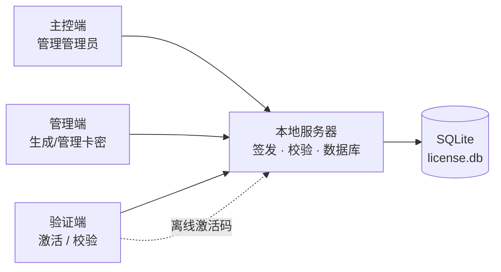

# 密钥授权系统 · Key Authorization System

> 一套完整、可**离线运行**的软件授权 / 卡密管理系统，包含 **本地服务器**、**管理端**、**验证端**、**主控端** 四个独立程序，开箱即用，无需安装 Python。

<p align="left">
  
  
  
  
</p>

---

## 一、项目简介

**密钥授权系统**用于对自研软件进行**授权发放与验证**：管理员在服务端批量生成卡密（密钥），客户端（验证端）凭卡密 + 设备硬件码完成激活与校验。系统支持**联网激活**与**离线激活**双模式，适合内网、无外网或需要严格管控授权的场景。

整套系统由四个可执行程序协作完成：

| 程序 | 角色 | 说明 |
| :--- | :--- | :--- |
| 🖥️ **本地服务器.exe** | 服务端 | 授权服务的核心：提供 REST API、管理 SQLite 数据库、签发与校验卡密。默认监听 `127.0.0.1:8765`，可无界面（headless）运行。 |
| 🛠️ **管理端.exe** | 管理员（admin） | 登录服务器后操作卡密：**批量生成**、吊销 / 恢复、冻结 / 解冻、解绑、查看统计与审计日志。 |
| ✅ **验证端.exe** | 客户端 | 面向最终用户：输入卡密与硬件码，联网校验或**离线激活**，显示授权状态与到期时间。 |
| 👑 **主控端.exe** | 超级管理员（master） | 最高权限：除卡密操作外，还可**管理管理员账号**、调整系统级设置。 |

> 默认首个账号：**`admin` / `admin123`**（角色 master），首次运行自动创建，请尽快修改密码。

---

## 二、功能特性

- 🔑 **卡密批量生成**：支持分钟卡 / 小时卡 / 天卡，多档时长、多版本（edition），一次生成多枚。
- 💻 **硬件绑定**：卡密与设备硬件码绑定，防止一码多用；支持解绑 / 换机。
- 📴 **离线激活**：基于纯 Python 实现的 **Ed25519 签名**（RFC 8032，非 cryptography 库），无需联网即可签发离线激活码（`LICACT1.` 前缀）。
- ⏸️ **冻结 / 解冻**：可临时冻结某张卡密指定时长（分钟 / 小时 / 天），到期自动恢复。
- ♻️ **吊销 / 恢复**：吊销的卡密可恢复，不会误伤，状态全程可追溯。
- 💓 **心跳机制**：客户端定时心跳，带**随机抖动（jitter）**，降低固定周期被识别的风险。
- 🔐 **签名与防重放**：HMAC-SHA256 请求签名 + nonce 防重放 + Bearer Token 鉴权 + 时间窗口校验。
- 🚦 **风控**：登录失败锁定、验证失败锁定、操作全部写入**审计日志**。
- 🎨 **现代化白色 UI**：全部基于 PySide6，统一的浅色主题，窗口自适应，杜绝溢出。

---

## 三、工作流程



1. 启动 **本地服务器** → 自动建库并创建主控账号。
2. 用 **管理端 / 主控端** 登录，批量生成卡密并分发给用户。
3. 用户运行 **验证端**，输入卡密完成激活；无网络时使用**离线激活**。
4. 服务器负责校验卡密状态（有效 / 冻结 / 吊销 / 过期）并记录日志。

---

## 四、快速开始

### 方式 A：直接使用（推荐）

1. 下载仓库（见下方「下载」），解压。
2. 进入 `dist/` 目录，先双击运行 **`本地服务器.exe`**，保持窗口开启。
3. 双击 **`主控端.exe`**，用 `admin / admin123` 登录（首次）。
4. 生成卡密 → 打开 **`验证端.exe`** 测试激活。

> 四个 exe 均为 **onefile 单文件**，免安装、**无需 Python 环境**。

### 方式 B：从源码运行

```bash
# 1. 安装依赖
pip install -r requirements.txt

# 2. 启动本地服务器（无界面模式）
python server/main.py --headless

# 或带图形界面启动
python server/main.py
```

---

## 五、下载

仓库已包含**完整源码 + 四个可执行程序**，任选一种方式获取全量包：

| 方式 | 操作 | 说明 |
| :--- | :--- | :--- |
| **整仓 ZIP** | 仓库页 → 绿色 **`Code`** → **`Download ZIP`** | 一键下载全量包（含源码与 `dist/` 下的 exe） |
| **Git 克隆** | `git clone git@github.com:GZY-SuQiu/SQ-Authorization-System.git` | 需配置 SSH 密钥 |
| **Release** | 仓库页右侧 **Releases** | 版本化发布包（如已发布） |

---

## 六、目录结构

```
密钥生成与绑定/
├── core/                 # 公共内核
│   ├── config.py         # 配置加载 / 默认配置 / 自动生成密钥
│   ├── security.py       # HMAC 签名、密码哈希、冻结时长计算
│   ├── machine.py        # 硬件码采集
│   ├── database.py       # SQLite 封装 + 表结构迁移
│   ├── api_client.py     # 服务端 API 客户端封装
│   ├── offline.py        # 纯 Python Ed25519（离线激活）
│   ├── theme.py          # 全局主题
│   ├── widgets.py        # 通用控件
│   ├── shell.py          # 主框架 / 导航
│   └── pages.py          # 关于页、作者与法律声明
├── server/               # 本地服务器（FastAPI）
│   ├── api.py            # 所有 REST 接口
│   ├── main.py           # 启动入口（支持 --headless）
│   └── ui.py             # 服务端界面
├── admin/                # 管理端
├── master/               # 主控端
├── verification/         # 验证端
├── dist/                 # 打包产物（四个 exe）
├── build.py              # PyInstaller 一键打包脚本
└── requirements.txt
```

---

## 七、接口一览（本地服务器）

| 分组 | 接口 |
| :--- | :--- |
| 基础 | `GET /api/health`、`GET /api/public_key` |
| 认证 | `POST /api/admin/login`、`GET /api/admin/me` |
| 卡密 | `POST /api/license/generate`、`GET /api/license/list`、`GET /api/license/detail`、`GET /api/license/stats` |
| 卡密操作 | `revoke`、`restore`、`freeze`、`unfreeze`、`revoke_batch`、`delete`、`unbind` |
| 离线 | `POST /api/license/offline_code` |
| 管理员 | `GET /api/admin/list`、`create`、`status`、`password` |
| 客户端 | `POST /api/client/activate`、`/verify`、`/heartbeat` |
| 日志 | `GET /api/logs` |

---

## 八、从源码构建 exe

```bash
pip install pyinstaller
python build.py
```

打包完成后，四个 exe 输出到 `dist/` 目录：

- `本地服务器.exe`（约 79 MB，控制台模式）
- `管理端.exe` / `验证端.exe` / `主控端.exe`（各约 55 MB，窗口模式）

---

## 九、配置与安全说明

- 运行时会自动生成 `config.json`，其中包含 **`secret_key`（HMAC 密钥）** 与 **离线签名私钥**。
- `config.json`、`data/`（授权数据库）已通过 `.gitignore` **排除在版本库之外**，请勿手动上传，以免泄露服务端密钥与授权数据。
- 服务端默认仅监听本机 `127.0.0.1:8765`；如需对外提供服务，请在配置中调整 `public_base_url` 并做好网络与访问控制。
- 全链路使用请求签名 + 时间窗口 + nonce 防重放，建议生产环境定期更换 `secret_key`。

---

## 十、常见问题

**Q：运行 exe 需要安装 Python 吗？**
A：不需要。四个程序均为单文件打包，双击即用。

**Q：验证端提示连接失败？**
A：请确认 **本地服务器.exe** 已启动，且端口 `8765` 未被占用 / 未被防火墙拦截。

**Q：忘记主控密码了？**
A：可删除 `data/license.db` 重新初始化（会清空数据），或在数据库中重置管理员记录。请谨慎操作并提前备份。

**Q：支持脱离本机、放到服务器上部署吗？**
A：支持。将 `本地服务器.exe` 部署到服务器，用 `--headless` 方式运行，并把客户端的 `server_url` 指向该服务器地址即可。

---

## 十一、作者与法律声明

**作者：苏丠** ｜ 版权所有 © 2026 苏丠，保留所有权利。

本软件（含本地服务器、管理端、验证端、主控端四个程序）由作者独立设计与开发，著作权归作者所有。

1. 本软件受《中华人民共和国著作权法》及相关法律法规保护，未经作者书面许可，任何单位或个人不得复制、传播、修改、反编译、出售或用于任何商业用途。
2. 本软件仅限用于合法的软件授权管理场景，使用者须确保其使用行为符合当地法律法规，不得用于侵犯他人合法权益或其他违法活动。
3. 使用者因使用本软件产生的一切后果由使用者自行承担；作者不对因使用或无法使用本软件造成的任何直接或间接损失负责。
4. 本软件按「现状」提供，作者保留随时修改、更新和终止本软件的权利。
