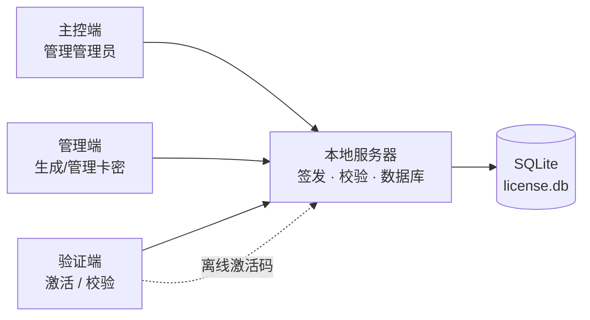

# 密钥授权系统 · Key Authorization System

> 一套完整、可**离线运行**的软件授权 / 卡密管理系统，包含 **本地服务器**、**管理端**、**验证端**、**主控端** 四个独立程序，开箱即用，无需安装 Python。

<p align="left">
  
  
  
  
</p>

---

## 一、项目简介

**密钥授权系统**用于对自研软件进行**授权发放与验证**：管理员在服务端批量生成卡密（密钥），客户端（验证端）凭卡密 + 设备硬件码完成激活与校验。系统支持**联网激活**与**离线激活**双模式，适合内网、无外网或需要严格管控授权的场景。

整套系统由四个可执行程序协作完成：

| 程序 | 角色 | 说明 |
| :--- | :--- | :--- |
| 🖥️ **本地服务器.exe** | 服务端 | 授权服务的核心：提供 REST API、管理 SQLite 数据库、签发与校验卡密。默认监听 `127.0.0.1:8765`，可无界面（headless）运行。 |
| 🛠️ **管理端.exe** | 管理员（admin） | 登录服务器后操作卡密：**批量生成**、吊销 / 恢复、冻结 / 解冻、解绑、查看统计与审计日志。 |
| ✅ **验证端.exe** | 客户端 | 面向最终用户：输入卡密与硬件码，联网校验或**离线激活**，显示授权状态与到期时间。 |
| 👑 **主控端.exe** | 超级管理员（master） | 最高权限：除卡密操作外，还可**管理管理员账号**、调整系统级设置。 |

> 首次启动会创建主控账号 `admin`，并生成**一次性随机初始密码**（GUI 会短暂显示，无界面模式会打印到控制台），请登录后立即修改。

---

## 二、功能特性

- 🔑 **卡密批量生成**：支持分钟卡 / 小时卡 / 天卡 / 星期卡 / 月卡 / 季卡 / 年卡，多档时长、多版本（edition），一次生成多枚。
- 🎫 **激活次数卡**：除时长卡外还可生成“激活次数卡”，自定义可激活次数（1 ~ 100000）。每绑定一台新机器消耗一次，同一机器重复激活不重复计数；次数用尽后卡密立即自动吊销（列表显示“已用尽”），所有设备都无法再校验或心跳，也无法恢复/续期。
- 🧩 **功能位授权**：卡密可携带功能位清单（如 pro / cloud / export），激活、校验、心跳、离线码全链下发；宿主软件用 SDK `has_feature()` 按功能放行（见 docs/FEATURE-FLAGS.md）。
- 🧵 **浮动席位 / 试用卡 / 固定到期日**：按“同时在线数”授权、防重领试用、企业式统一到期日（见 docs/LICENSE-TYPES.md）。
- 📊 **数据看板 / 二维码 / 深色主题**：生成·激活·到期趋势图、卡密与离线码二维码、全界面深色模式（见 docs/UI-B5.md）。
- 💻 **硬件绑定**：卡密与设备硬件码绑定，防止一码多用；支持解绑 / 换机。
- 📴 **离线激活**：使用成熟的 `cryptography` Ed25519 实现，服务端持离线签名私钥，客户端固定服务端公钥后即可验证离线激活码（`LICACT1.` 前缀）。离线激活码只针对时长卡；激活次数卡必须联网激活，以保证次数扣减准确。
- ⏸️ **冻结 / 解冻**：可临时冻结某张卡密指定时长（分钟 / 小时 / 天），到期自动恢复。
- ♻️ **吊销 / 恢复**：吊销的卡密可恢复，不会误伤，状态全程可追溯。
- 💓 **心跳机制**：客户端定时心跳，带**随机抖动（jitter）**，降低固定周期被识别的风险。
- 🔐 **签名与防重放**：激活/校验/心跳使用 HMAC-SHA256 请求签名、nonce 防重放和时间窗口；服务器响应使用固定 Ed25519 响应公钥签名。管理 API 使用 Bearer Token，远程部署必须配合 HTTPS。
- 🚦 **风控**：登录失败锁定、验证失败锁定、操作全部写入**审计日志**。
- 🗂️ **批次管理**：按批次聚合统计生成量与激活量，支持按批次筛选、整批吊销与多选批量操作。
- 🧾 **审计与导出**：操作日志支持关键词 / 操作类型筛选、分页与 CSV 导出，密钥列表同样支持导出。
- 💾 **备份与恢复**：服务端界面可一键备份数据库（含完整性校验）并从备份恢复，默认落在 `data/backups/`。
- 🧹 **日志保留**：审计日志带时间索引，可按时长清理，避免数据库无限增长。
- 🚪 **强制改密**：密码被重置的账号登录后会被控制在改密页，改完才能使用其他功能。
- 🎨 **现代化白色 UI**：全部基于 PySide6，统一的浅色主题，窗口自适应，杜绝溢出。

---

## 三、工作流程



1. 启动 **本地服务器** → 自动建库并创建主控账号。
2. 用 **管理端 / 主控端** 登录，批量生成卡密并分发给用户。
3. 用户运行 **验证端**，输入卡密完成激活；无网络时使用**离线激活**。
4. 服务器负责校验卡密状态（有效 / 冻结 / 吊销 / 过期）并记录日志。

---

## 四、快速开始

### 方式 A：直接使用（推荐）

1. 下载仓库（见下方「下载」），解压。
2. 进入 `dist/` 目录，先双击运行 **`本地服务器.exe`**，保持窗口开启。
3. 双击 **`主控端.exe`**，用 `admin` 和界面显示的随机初始密码登录（首次）。
4. 生成卡密 → 打开 **`验证端.exe`** 测试激活。

> 四个 exe 均为 **onefile 单文件**，免安装、**无需 Python 环境**。

### 方式 B：从源码运行

```bash
# 1. 安装依赖
pip install -r requirements.txt

# 2. 启动本地服务器（无界面模式）
python server/main.py --headless

# 或带图形界面启动
python server/main.py
```

服务端还提供几个维护参数：

```bash
python server/main.py --reset-master-password   # 重置主控密码（不清数据）
python server/main.py --print-public-key        # 导出客户端需要固定的公钥
python server/main.py --version                 # 查看版本
```

---

## 五、下载

仓库已包含**完整源码 + 四个可执行程序**，任选一种方式获取全量包：

| 方式 | 操作 | 说明 |
| :--- | :--- | :--- |
| **整仓 ZIP** | 仓库页 → 绿色 **`Code`** → **`Download ZIP`** | 一键下载全量包（含源码与 `dist/` 下的 exe） |
| **Git 克隆** | `git clone git@github.com:GZY-SuQiu/SQ-Authorization-System.git` | 需配置 SSH 密钥 |
| **Release** | 仓库页右侧 **Releases** | 版本化发布包（如已发布） |

---

## 六、目录结构

```
密钥生成与绑定/
├── core/                 # 公共内核
│   ├── config.py         # 配置加载 / 默认配置 / 自动生成密钥
│   ├── security.py       # HMAC 签名、密码哈希、冻结时长计算
│   ├── machine.py        # 硬件码采集
│   ├── database.py       # SQLite 封装 + 表结构迁移
│   ├── api_client.py     # 服务端 API 客户端封装
│   ├── offline.py        # Ed25519（cryptography）离线激活编解码
│   ├── theme.py          # 全局主题
│   ├── widgets.py        # 通用控件
│   ├── shell.py          # 主框架 / 导航
│   └── pages.py          # 通用页面、改密页、作者与法律声明
├── server/               # 本地服务器（FastAPI）
│   ├── api.py            # 所有 REST 接口
│   ├── main.py           # 启动入口（支持 --headless）
│   └── ui.py             # 服务端界面
├── admin/                # 管理端
├── master/               # 主控端
├── verification/         # 验证端
├── dist/                 # 打包产物（四个 exe）
├── tools/                # 开发辅助：页面离屏渲染、像素回归检查、会话密钥迁移预览
├── build.py              # PyInstaller 一键打包脚本
└── requirements.txt
```

---

## 七、接口一览（本地服务器）

| 分组 | 接口 |
| :--- | :--- |
| 基础 | `GET /api/health`、`GET /api/public_key` |
| 认证 | `POST /api/admin/login`、`GET /api/admin/me` |
| 卡密 | `POST /api/license/generate`、`GET /api/license/list`、`GET /api/license/detail`、`GET /api/license/stats` |
| 批次 | `GET /api/license/batches`（按批次聚合统计，支持关键词筛选） |
| 卡密操作 | `revoke`、`restore`、`renew`、`freeze`、`unfreeze`、`revoke_batch`、`delete`、`unbind` |
| 离线 | `POST /api/license/offline_code` |
| 管理员 | `GET /api/admin/list`、`create`、`status`、`password`、`change_password` |
| 客户端 | `POST /api/client/activate`、`/verify`、`/heartbeat` |
| 日志 | `GET /api/logs` |

> 客户端的 `activate` / `verify` / `heartbeat` 必须携带 `X-Client-Signature`，签名覆盖方法、路径、**查询串**、时间戳、nonce 与原始请求体。

---

## 八、从源码构建 exe

```bash
pip install pyinstaller
python build.py
```

打包完成后，四个 exe 输出到 `dist/` 目录：

- `本地服务器.exe`（约 57.1 MB，控制台模式）
- `管理端.exe` / `验证端.exe` / `主控端.exe`（各约 52.4 MB，窗口模式）

---

## 九、配置与安全说明

- 运行时按角色生成 `server_config.json`、`admin_config.json`、`master_config.json`、`verification_config.json`。
- `server_config.json` 才包含 HMAC 密钥、离线签名私钥和响应签名私钥；管理端/主控端/验证端配置只保存连接参数和固定的服务端公钥，绝不会生成或保存服务端私钥。
- 所有角色配置、`data/`（授权数据库）和构建产物均已通过 `.gitignore` 排除，请勿手动上传。
- 服务端默认仅监听本机 `127.0.0.1:8765`。远程部署必须使用 HTTPS/受信证书，并在客户端固定服务端响应公钥（可用 `python server/main.py --print-public-key` 导出）；管理 API 仍依赖 Bearer Token，绝不能裸 HTTP 暴露。

数据库与密钥的补充说明：

- 激活记录的**会话密钥在库内加密存储**（AES-GCM，密钥由 `server_config.json` 的 `secret_key` 派生）。单独拷走 `license.db` 无法伪造设备签名。
- 因此 `server_config.json` 与 `license.db` 必须**一同备份**；丢失配置中的 `secret_key` 会使已签发的会话密钥无法解密（客户端重新激活即可恢复）。
- 首次启动时会把历史版本遗留的明文会话密钥自动升级为加密存储，旧数据不需要迁移。
- 口令使用 `PBKDF2-SHA256`（600,000 次迭代）并带版本标识，旧库的 120,000 次哈希仍可登录。
- 登录具备账号级与**来源 IP 级**双重限流，未知账号同样执行完整口令哈希，避免通过响应耗时枚举账号。
- 服务端配置文件与数据库在写入后会尽力收紧本机访问权限（POSIX `chmod 600`；Windows 使用 `icacls` 移除继承）。

---

## 十、功能说明与验收要点
### Windows 深色模式黑带修复（UI）

- 现象：Windows 深色模式下，服务器设置面板、验证端页面与 AI 助手聊天区滚动时出现整条黑色横带（白界面里夹一条黑边）。
- 根因：滚动内容层是透明的，滚动时新露出的条带没有被任何一层绘制；深层还叠着 windows11 原生风格按系统深色主题绘制的子控件。
- 修复：滚动区、视口与内容层全部改为不透明页面底色；启动时强制浅色 `QPalette` 并统一切换 `Fusion` 样式（`SQ_KEEP_NATIVE_STYLE=1` 可保留系统原生风格）；标题栏/边框用 DWM 强制浅色。
- 回归测试：`tests/test_theme_dark_mode.py`（深色调色板被覆盖、滚动无黑带、四个端的滚动内容层均不透明）；扫描工具 `python tools/dark_mode_sweep.py` 覆盖四个端所有页面与滚动位置。
- 控制台：服务器 exe 双击运行时隐藏自带控制台窗口；从 cmd / Windows Terminal 启动不会隐藏终端窗口（`--show-console` 可强制保留）。

### 发布完整性自校验（C1）

- 构建时 `build.py` 会生成/复用发布密钥对（`release_keys/release_key.json`，已加入 `.gitignore`，**必须离线备份**，泄露等于泄露签名能力），并在打包前把公钥固定进四个 exe。
- `python build.py` 完成后输出：`dist/release_manifest.json`、`dist/release_manifest.sig`、`dist/releases/` 副本，并打印公钥指纹。
- **分发规则**：每个 exe 必须与 `release_manifest.json`、`release_manifest.sig` 放在同一目录。清单缺失/签名不对、exe 哈希不一致、`required_apps` 缺失、或目录里多出未登记的 `.exe/.dll`，启动直接拒绝：弹窗 + 写 `integrity_tamper.log` + 尽力上报服务器。
- 服务器启动时自动验签并导入 `releases/` 下的清单到发布白名单（`release_hashes` 表）。`server_config.json` 的 `security.attest_mode` 支持 `auto`（默认，白名单非空即强制）/ `strict` / `off`，`attest_token_ttl_seconds` 默认 600 秒。
- 白名单生效后，`activate` / `verify` / `heartbeat` 必须携带 `X-Attest-Token`；未知或被篡改的客户端返回 403「客户端完整性校验未通过，已拒绝访问」，事件写入 `tamper_events`，并出现在审计日志的「完整性校验失败 / 完整性告警」中。
- 发布密钥轮换会使旧 exe 无法通过新清单校验，必须配合版本升级与灰度发布；操作细节见 `docs/RELEASE-SIGNING.md`。
- 验收命令：`python tools/verify_integrity_e2e.py`（验签、篡改拒绝、真实 attest 门禁全链路）。

### 邮箱账号与邮件告警（P1）

- SMTP 配置：打开 **本地服务器** → 设置 → SMTP 分组，填写主机/端口/账号/密码/发件邮箱/STARTTLS/SSL/超时与管理员告警收件邮箱。保存后需重启本地服务器生效；"发送测试邮件"可立即验证通道。
- 管理员邮箱：主控端"管理员管理"可为账号设置邮箱并输入验证码；登录框新增"忘记密码"，通过邮箱验证码重置密码。
- 验证端邮箱登录：验证端顶部可切换"邮箱登录 / 激活码"。邮箱支持注册、登录、忘记密码、绑定并激活、校验、请求续费、脱绑、退出。规则为**一个邮箱同一时间只能绑定一个 Key**；Key 仍有效时禁止自助脱绑（返回 409），过期/吊销/次数用尽后可自助脱绑并释放设备。
- 告警规则（内置）：检测到新硬件码抢占已满的设备位 → 冻结该 Key + 邮件告警；同一 Key 在 10 分钟内出现超过 2 个 IP 网段 → 邮件告警；可执行文件完整性校验失败/未知发布哈希 → 邮件告警。阈值可在 `server_config.json` 的 `security.ip_jump_window_minutes` / `ip_jump_alert_threshold` 调整。
- 收件人：触发 Key 的绑定邮箱 + `smtp.alert_admin_emails` 中配置的管理员 + 已绑定并验证邮箱的管理员账号；均未配置时静默跳过。
- 邮件队列：所有通知写 `email_outbox`，后台 worker 每 5 秒投递，失败按指数退避重试（最多 5 次后进 dead），不会阻塞请求；投递记录见 `GET /api/email/outbox`。
- 验收命令：`python tools/verify_mail_e2e.py`（内置假 SMTP，覆盖注册/验证/找回密码/绑定/续费全链路）。

### 告警中心与多渠道通知（A5/A7）

- 管理端/主控端新增 **告警中心** 导航：
  - **告警规则**：7 个内置指标（激活率、在线并发、过期率、7 天内到期、激活失败、风控事件、完整性告警），可配置运算符、阈值、统计窗口、级别、冷却时间、通知渠道与启停。
  - **告警事件**：触发中/已确认/已处理三种状态，支持筛选、确认、标记已处理与 15 秒自动刷新；同一规则同时只保留一个活动事件，指标恢复后自动 resolved，冷却期内不重复触发。
  - **通知渠道**：Webhook / 钉钉 / 企业微信 / 飞书四种渠道的增删改查、测试发送与投递记录；Webhook 自动附加 `X-SQ-Signature: sha256=<hmac>`，钉钉/飞书支持官方加签。
- 通知投递：邮件走 `email_outbox`，其它渠道走 `channel_outbox`，均在后台线程投递，失败按指数退避重试（最多 5 次进 dead），不阻塞请求。
- 规则渠道可同时勾选"邮件"和任意已启用渠道（存为 `channel:<id>`）；无收件人/未启用时事件仍落库，`notified=0`。
- 验收命令：
  - `python tools/verify_channels_e2e.py`（规则 → channel_outbox → 真实 HTTP 投递 + HMAC 校验）
  - `python tools/verify_mail_e2e.py`（含 A5 规则触发与邮件通知链路）

### 用户资料、用户管理与 Python SDK（缺陷修复批次）

- 验证端邮箱模式：登录后显示头像、显示名与邮箱；"编辑资料"支持修改名称、上传/移除头像（png/jpg/webp，≤256KB）。
- 管理端/主控端新增 **用户管理**：搜索邮箱注册用户、查看绑定与许可证状态、启用/禁用、强制脱绑。两端界面已区分：管理端=密钥运营（无"管理员管理/系统设置"），主控端=系统管理。
- 验证端 **可脱离发布文件独立运行**：缺少 `release_manifest.json` / `.sig` 时进入 standalone 模式（不弹窗、不退出）；文件存在但被篡改仍拒绝启动。admin/master/server 角色仍严格校验。
- **Python SDK**：`sdk/sq_license_client.py` 供自研软件内嵌授权校验（激活/校验/心跳/离线码），不读取配置文件、不依赖清单；接入文档 `docs/SDK-PYTHON.md`，示例 `examples/embed_license_demo.py`。SDK 请求带 `X-Client-Kind: sdk`，服务器默认豁免"宿主 exe 白名单"这一层（会话 HMAC、设备绑定、响应验签仍然生效）。
- **发布文件加固**：每次构建生成新的 `release_id`（写入 `core/release_identity.py`），清单携带 `release_id` 并参与 Ed25519 签名；attest 同时校验 `release_id` 与 manifest sha256，替换或混用发布清单会被判 `release_mismatch` 并记录告警。
- **服务端性能**：统计结果 5 秒缓存、过期扫描 60 秒节流、补齐热点索引、邮件/渠道 worker 空队列不再抢占写锁、服务器界面刷新 3 秒改为 10 秒且只预览 50 条日志。基准工具 `python tools/bench_server.py`。

### SMTP 排错与邮箱服务修复

- `503 need EHLO and AUTH first` 已修复：发送状态机现在严格按 EHLO →（STARTTLS 后重新 EHLO）→ AUTH → MAIL FROM 执行；若仍遇到，通常是没启用认证或用户名缺失。请填写完整邮箱作为用户名 + 授权码（QQ/163/企业邮箱使用授权码，不是网页登录密码）；465 勾 SSL，587 勾 STARTTLS，二者不能同时开。
- 已修复 `socket.getfqdn()` 本机反解析导致**每封邮件卡 12 秒**的问题（显式 `local_hostname` + `make_msgid(domain=...)`）。
- SMTP 配置保存后**立即生效**，无需重启服务；"发送测试邮件"会直接弹出可读的错误原因（附带 503/535/550 处理建议）。
- 保存时会校验：SSL 与 STARTTLS 互斥、用户名/密码成对、发件人必填，坏配置不允许保存。

### 发布安全规范

- `python build.py` 会生成 **`dist/release_package/`**：只包含 4 个 exe + `release_manifest.json/.sig` + `releases/`。构建自动做卫生检查，发现任何 config/db/私钥文件直接失败。**对外只分发这个目录，不要分发整个 `dist/`。**
- 每次构建生成新的 `release_id` 并参与签名；attest 会校验 `release_id` 与（可选的）manifest 哈希。
- 新增安全开关（`server_config.json → security`）：
  - `sdk_attest_exempt`（默认 false）+ `sdk_shared_secret`：SDK 嵌入第三方宿主程序时，需同时设置密钥并携带 `X-SDK-Token = HMAC(secret, machine_code)` 才豁免宿主白名单。
  - `require_manifest_hash`（默认 false）：设为 true 时 attest 必须携带非空 `manifest_sha256`（适合全量分发清单的模式；会使验证端 standalone 无法通过 attest）。
  - `channel_allow_private_hosts`（默认 false）：允许通知渠道指向内网/本机地址（内网 Webhook 场景才打开）。
- 对抗审计与修复记录见 `docs/SELF-AUDIT.md`；旧密钥与旧数据已备份到 `backup_secrets_20261008/`，切勿随包分发。

### 登录记忆与首次引导

- 验证端「邮箱登录」与管理端/主控端登录框都新增 **「记住账号」「记住密码（本机加密保存）」**；勾选记住密码会自动锁定记住账号。
- 密码使用 **Windows DPAPI** 加密后存储（密文仅当前 Windows 用户可解，配置文件被拷走也无法直接还原明文）；非 Windows 平台没有等价能力，只允许记住账号并给出提示。
- 服务器首次运行的引导弹窗新增 **「复制账号」「复制密码」** 独立按钮（同时保留「复制账号密码」整体复制）。
- 升级说明：旧配置中的明文密码不会被读取，需要在登录框重新勾选一次"记住密码"；随后即以 DPAPI 密文保存。

## 十、常见问题

**Q：运行 exe 需要安装 Python 吗？**
A：不需要。四个程序均为单文件打包，双击即用。

**Q：验证端提示连接失败？**
A：请确认 **本地服务器.exe** 已启动，且端口 `8765` 未被占用 / 未被防火墙拦截。

**Q：忘记主控密码了？**
A：不要删数据库。停掉服务器后执行 `python server/main.py --reset-master-password`（exe 版为 `本地服务器.exe --reset-master-password`），它会为 `admin` 重新生成一次性密码并保留全部授权数据，登录后会被要求立即改密。

**Q：支持脱离本机、放到服务器上部署吗？**
A：可以，但必须先配置 HTTPS/受信证书，并将 `--print-public-key` 导出的服务端响应公钥固定到客户端配置；远程明文 HTTP 会被客户端直接拒绝，除非显式允许内网测试。

**Q：Windows 深色模式下界面还有黑条/黑边？**
A：请确认运行的是最新构建（`dist/release_package/` 里的 exe）。当前版本已强制浅色配色与 `Fusion` 样式，并把滚动内容层改成不透明实底；若从 cmd / Windows Terminal 启动，终端窗口不会被隐藏，属预期行为。

---

## 十一、作者与法律声明

**作者：苏丠** ｜ 版权所有 © 2026 苏丠，保留所有权利。

本软件（含本地服务器、管理端、验证端、主控端四个程序）由作者独立设计与开发，著作权归作者所有。

1. 本软件受《中华人民共和国著作权法》及相关法律法规保护，未经作者书面许可，任何单位或个人不得复制、传播、修改、反编译、出售或用于任何商业用途。
2. 本软件仅限用于合法的软件授权管理场景，使用者须确保其使用行为符合当地法律法规，不得用于侵犯他人合法权益或其他违法活动。
3. 使用者因使用本软件产生的一切后果由使用者自行承担；作者不对因使用或无法使用本软件造成的任何直接或间接损失负责。
4. 本软件按「现状」提供，作者保留随时修改、更新和终止本软件的权利。
